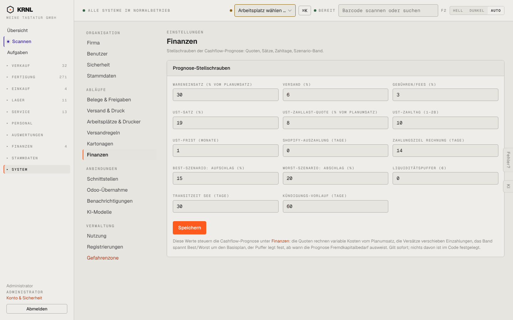

# 980-einstellungen-finanzen — Finanz-Parameter

- **Bereich:** Stammdaten & System
- **Route:** `/einstellungen/finanzen`
- **Note:** 3 / 5
- **Zweck:** Stellschrauben der Cashflow-Prognose
- **Messwerte:** HTTP 200 · Ladezeit 849 ms · Seitenhöhe 900 px · horizontaler Überlauf nein · Texte < 11 px: 32

## Was gut ist

- Erklärtext, wie die Werte wirken

## Befunde

| Schwere | Kategorie | Befund | Vorschlag |
|---|---|---|---|
| **mittel** | Eingabe | 14 nackte Zahlenfelder ohne Einheiten im Feld (%, Tage, €) und ohne Gruppierung. | Gruppen (Kosten, Steuer, Zahlungsziele, Szenarien) mit Einheit im Feld. |

[← zur Übersicht](../README.md)
