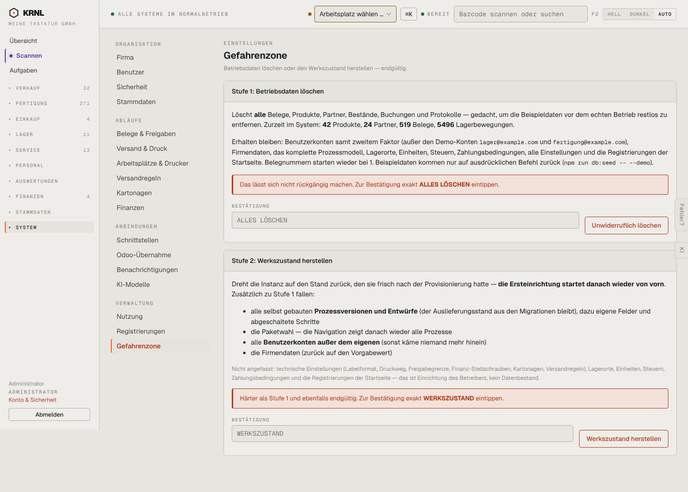

# 980-einstellungen-gefahrenzone — Gefahrenzone

- **Bereich:** Stammdaten & System
- **Route:** `/einstellungen/gefahrenzone`
- **Note:** 4 / 5
- **Zweck:** Betriebsdaten löschen / Werkszustand
- **Messwerte:** HTTP 200 · Ladezeit 840 ms · Seitenhöhe 1031 px · horizontaler Überlauf nein · Texte < 11 px: 20

## Was gut ist

- Zwei Stufen klar getrennt, Folgen ausführlich aufgezählt
- Bestätigung durch Eintippen eines Wortes

## Befunde

| Schwere | Kategorie | Befund | Vorschlag |
|---|---|---|---|
| **niedrig** | Texte | Befehl ‚npm run db:seed -- --demo‘ im Anwendertext. | Technische Hinweise ausblenden. |

[← zur Übersicht](../README.md)
