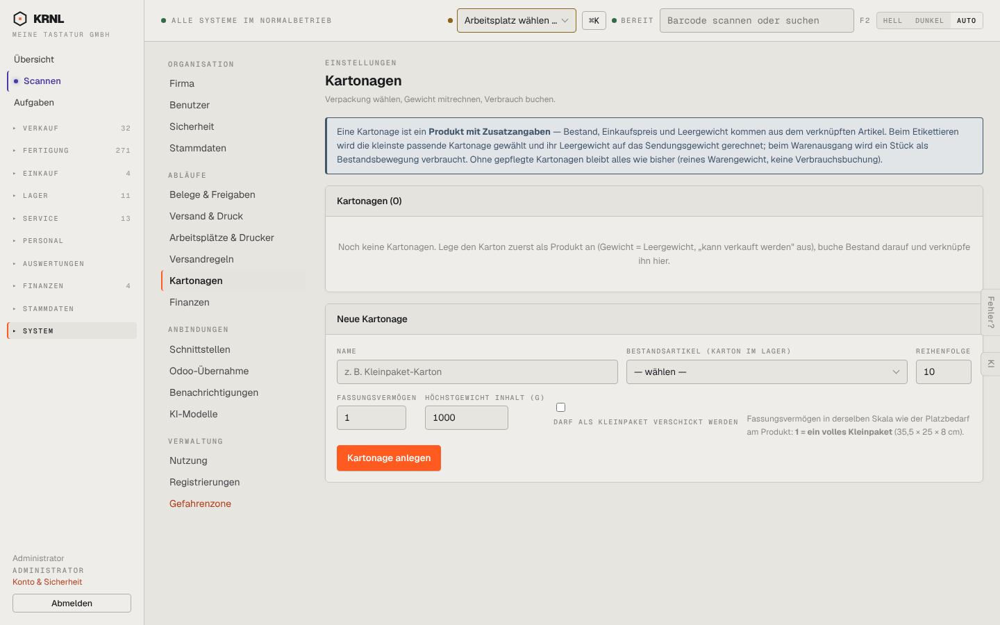

# 980-einstellungen-kartonagen — Kartonagen

- **Bereich:** Stammdaten & System
- **Route:** `/einstellungen/kartonagen`
- **Note:** 3 / 5
- **Zweck:** Kartonagen (Verpackung mit Gewicht/Verbrauch)
- **Messwerte:** HTTP 200 · Ladezeit 892 ms · Seitenhöhe 900 px · horizontaler Überlauf nein · Texte < 11 px: 24

## Was gut ist

- Erklärung des Konzepts ‚Produkt mit Zusatzangaben‘

## Befunde

| Schwere | Kategorie | Befund | Vorschlag |
|---|---|---|---|
| **niedrig** | Eingabe | Felder mit Werten 10/1/1000 vorbelegt, Checkbox ‚darf als Kleinpaket verschickt werden‘ ohne Label-Ausrichtung. | Platzhalter statt Werte, Schalter mit Label. |

[← zur Übersicht](../README.md)
