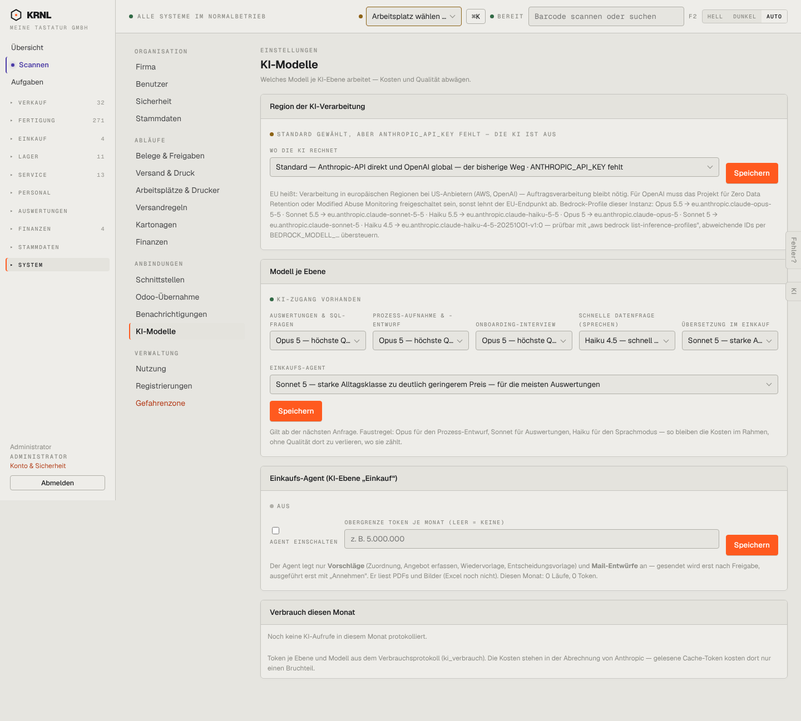

# 980-einstellungen-ki — KI-Modelle

- **Bereich:** Stammdaten & System
- **Route:** `/einstellungen/ki`
- **Note:** 3 / 5
- **Zweck:** KI-Region, Modell je Ebene, Einkaufs-Agent, Verbrauch
- **Messwerte:** HTTP 200 · Ladezeit 828 ms · Seitenhöhe 1297 px · horizontaler Überlauf nein · Texte < 11 px: 27

## Was gut ist

- Region mit klarer Statuszeile (‚ANTHROPIC_API_KEY fehlt – die KI ist aus‘)
- Modelle je Ebene mit Faustregel

## Befunde

| Schwere | Kategorie | Befund | Vorschlag |
|---|---|---|---|
| **hoch** | Status | Widerspruch: oben ‚KI ist aus (Schlüssel fehlt)‘, darunter ‚● KI-Zugang vorhanden‘. | Ein gemeinsamer Status je Anbieter. |
| **mittel** | Texte | Erklärtext zur EU-Region listet Bedrock-Profil-IDs und Umgebungsvariablen – unlesbar für Betreiber. | Kurzfassung + ‚Technische Details‘ aufklappbar. |

[← zur Übersicht](../README.md)
