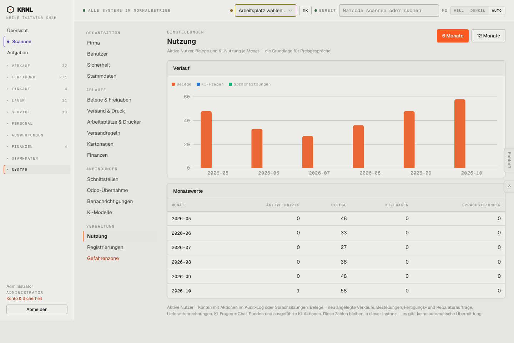

# 980-einstellungen-nutzung — Nutzung

- **Bereich:** Stammdaten & System
- **Route:** `/einstellungen/nutzung`
- **Note:** 3 / 5
- **Zweck:** Nutzungszahlen je Monat (Grundlage für Preisgespräche)
- **Messwerte:** HTTP 200 · Ladezeit 897 ms · Seitenhöhe 963 px · horizontaler Überlauf nein · Texte < 11 px: 29

## Was gut ist

- Diagramm + Monatstabelle, Erklärung der Kennzahlen

## Befunde

| Schwere | Kategorie | Befund | Vorschlag |
|---|---|---|---|
| **niedrig** | Daten | Aktive Nutzer 0 in allen Vormonaten trotz Belegen (Testdaten) – Diagramm zeigt nur Belege. | Legende nur für vorhandene Reihen; Hinweis bei Nullreihen. |

[← zur Übersicht](../README.md)
