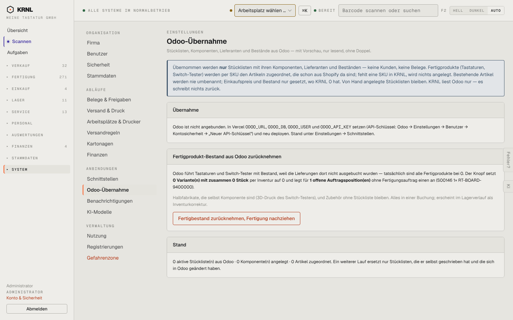

# 980-einstellungen-odoo — Odoo-Übernahme

- **Bereich:** Stammdaten & System
- **Route:** `/einstellungen/odoo`
- **Note:** 3 / 5
- **Zweck:** Odoo-Übernahme (Stücklisten, Komponenten) und Fertigbestand-Korrektur
- **Messwerte:** HTTP 200 · Ladezeit 872 ms · Seitenhöhe 900 px · horizontaler Überlauf nein · Texte < 11 px: 18

## Was gut ist

- Banner erklärt genau, was übernommen wird

## Befunde

| Schwere | Kategorie | Befund | Vorschlag |
|---|---|---|---|
| **mittel** | Logik | Knopf ‚Fertigbestand zurücknehmen, Fertigung nachziehen‘ ist aktiv, obwohl Odoo nicht angebunden ist und 0 Varianten betroffen sind. | Deaktivieren bei 0 Treffern/ohne Anbindung. |
| **niedrig** | Navigation | Einmalige Migrationsfunktion dauerhaft in der Einstellungsnavigation. | Nach Abschluss ausblenden oder unter ‚Einrichtung‘. |

[← zur Übersicht](../README.md)
