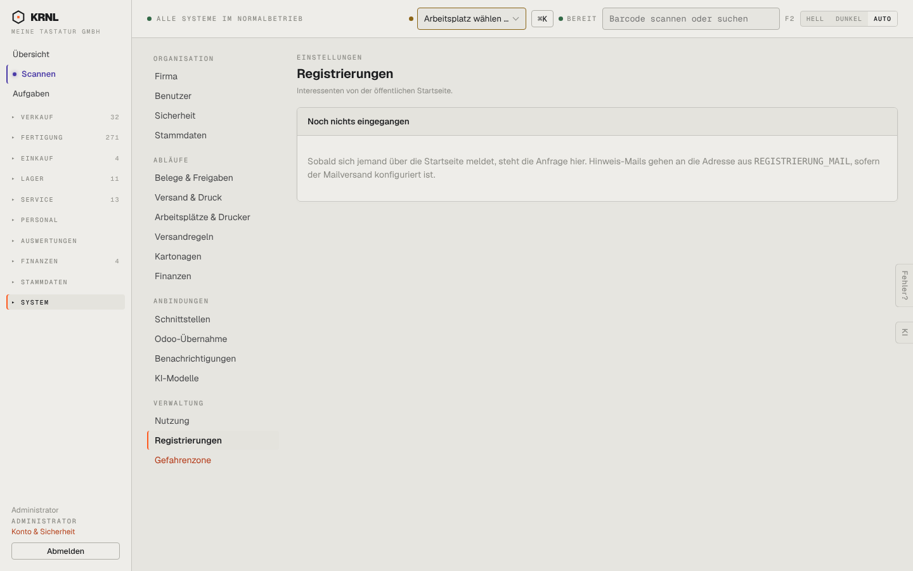

# 980-einstellungen-registrierungen — Registrierungen

- **Bereich:** Stammdaten & System
- **Route:** `/einstellungen/registrierungen`
- **Note:** 4 / 5
- **Zweck:** Interessenten von der öffentlichen Startseite
- **Messwerte:** HTTP 200 · Ladezeit 817 ms · Seitenhöhe 900 px · horizontaler Überlauf nein · Texte < 11 px: 18

## Was gut ist

- Leerzustand erklärt Quelle und Mailziel

## Befunde

| Schwere | Kategorie | Befund | Vorschlag |
|---|---|---|---|
| **niedrig** | Navigation | Vertriebsliste unter Einstellungen – gehört eher zu Verkauf/Kontakte. | Unter Verkauf führen. |

[← zur Übersicht](../README.md)
