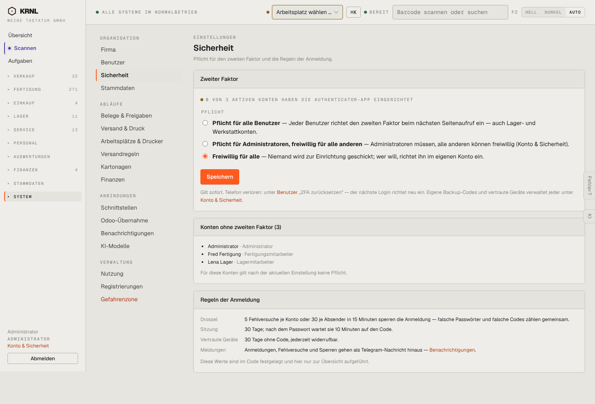

# 980-einstellungen-sicherheit — Sicherheit

- **Bereich:** Stammdaten & System
- **Route:** `/einstellungen/sicherheit`
- **Note:** 4 / 5
- **Zweck:** 2FA-Pflicht und Anmelderegeln
- **Messwerte:** HTTP 200 · Ladezeit 866 ms · Seitenhöhe 979 px · horizontaler Überlauf nein · Texte < 11 px: 19

## Was gut ist

- Drei Pflichtstufen klar erklärt
- Konten ohne 2FA aufgelistet
- Regeln der Anmeldung transparent

## Befunde

| Schwere | Kategorie | Befund | Vorschlag |
|---|---|---|---|
| **niedrig** | Status | ‚0 von 3 Konten haben die Authenticator-App‘ in Gelb – bei Admin-Konto ohne 2FA wäre eine deutlichere Empfehlung angebracht. | Empfehlung ‚Mindestens Administratoren absichern‘ als Hinweisbox. |

[← zur Übersicht](../README.md)
