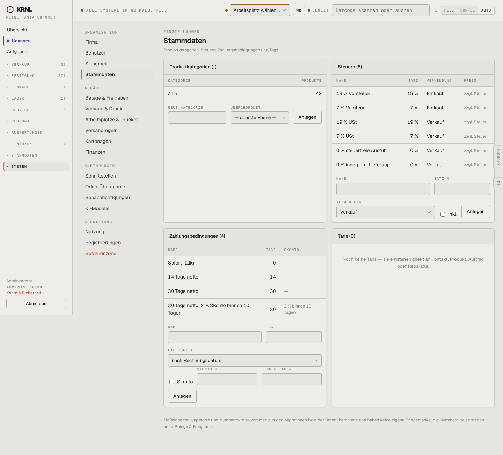

# 980-einstellungen-stammdaten — Stammdaten-Einstellungen

- **Bereich:** Stammdaten & System
- **Route:** `/einstellungen/stammdaten`
- **Note:** 3 / 5
- **Zweck:** Kategorien, Steuern, Zahlungsbedingungen, Tags
- **Messwerte:** HTTP 200 · Ladezeit 902 ms · Seitenhöhe 1302 px · horizontaler Überlauf nein · Texte < 11 px: 37

## Was gut ist

- Siehe 904 (gleiche Seite)

## Befunde

| Schwere | Kategorie | Befund | Vorschlag |
|---|---|---|---|
| **niedrig** | Konsistenz | Identisch mit 904 – zwei Einstiege (Produkte → Kategorien & Steuern, Einstellungen → Stammdaten). | Siehe 904. |

[← zur Übersicht](../README.md)
