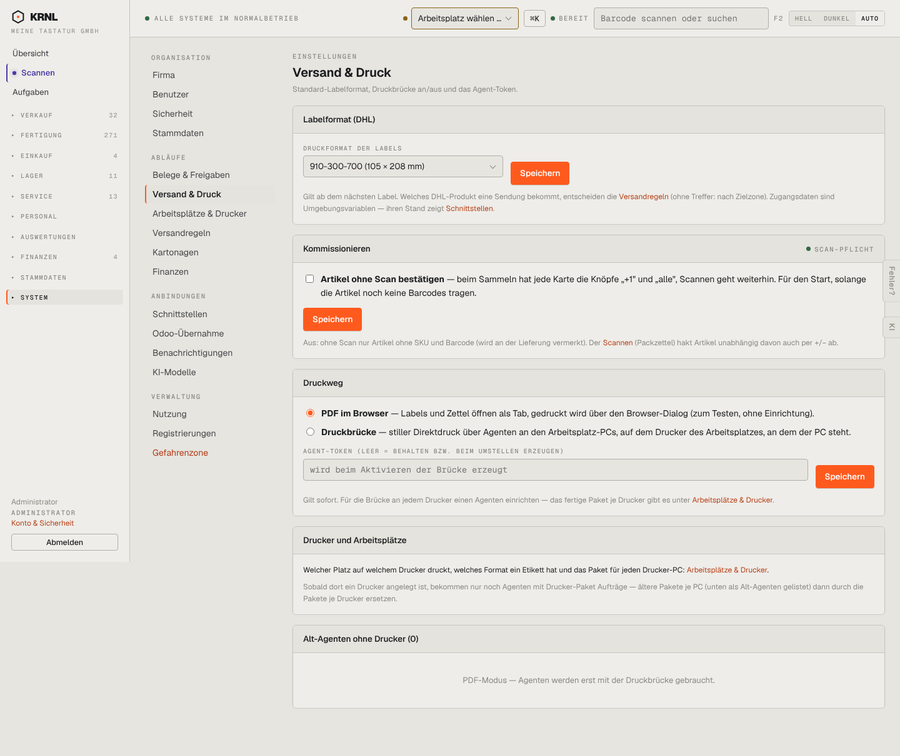

# 980-einstellungen-versand — Versand-Einstellungen

- **Bereich:** Stammdaten & System
- **Route:** `/einstellungen/versand`
- **Note:** 3 / 5
- **Zweck:** Labelformat, Kommissionieren (Scan-Pflicht), Druckweg
- **Messwerte:** HTTP 200 · Ladezeit 809 ms · Seitenhöhe 1211 px · horizontaler Überlauf nein · Texte < 11 px: 20

## Was gut ist

- Druckweg PDF/Druckbrücke klar erklärt
- Scan-Pflicht als Schalter mit Folgen

## Befunde

| Schwere | Kategorie | Befund | Vorschlag |
|---|---|---|---|
| **niedrig** | Layout | Vier Karten mit je eigenem Speichern-Knopf. | Ein Speichern je Seite oder Autosave. |

[← zur Übersicht](../README.md)
