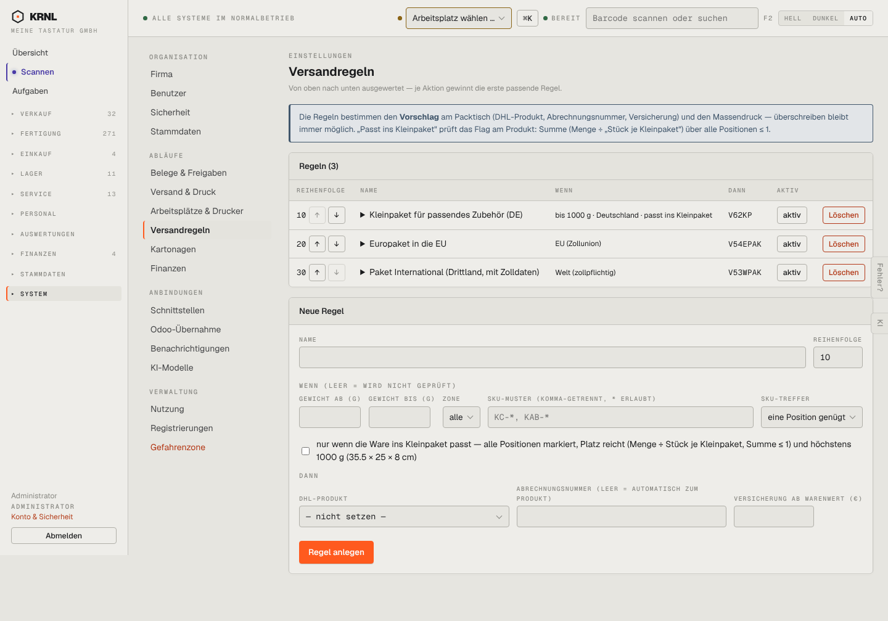

# 980-einstellungen-versandregeln — Versandregeln

- **Bereich:** Stammdaten & System
- **Route:** `/einstellungen/versandregeln`
- **Note:** 3 / 5
- **Zweck:** Regeln für DHL-Produkt-Vorschlag
- **Messwerte:** HTTP 200 · Ladezeit 878 ms · Seitenhöhe 1007 px · horizontaler Überlauf nein · Texte < 11 px: 71

## Was gut ist

- Reihenfolge mit ↑/↓, Bedingung und Ergebnis je Regel lesbar

## Befunde

| Schwere | Kategorie | Befund | Vorschlag |
|---|---|---|---|
| **mittel** | Eingabe | Formular ‚Neue Regel‘ mit 10 Feldern ohne Vorschau, welche Lieferungen die Regel treffen würde. | Live-Vorschau ‚trifft 12 der letzten 50 Lieferungen‘. |
| **niedrig** | Konsistenz | Rote ‚Löschen‘-Knöpfe je Zeile. | Zeilenmenü. |

[← zur Übersicht](../README.md)
