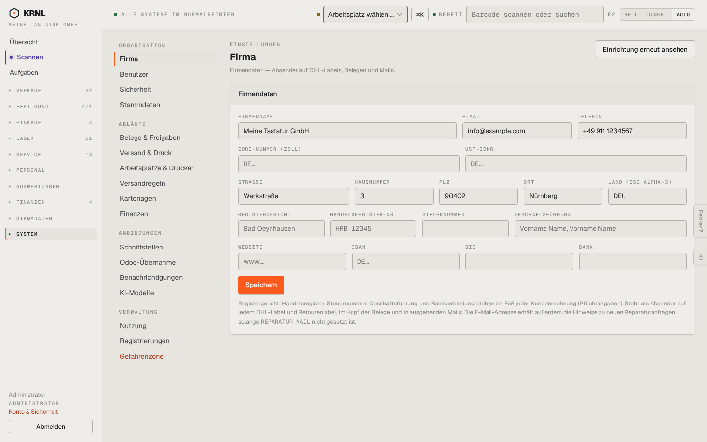

# 980-einstellungen — Einstellungen (Firma)

- **Bereich:** Stammdaten & System
- **Route:** `/einstellungen`
- **Note:** 3 / 5
- **Zweck:** Einstellungen → Firma (Startseite der Einstellungen): Firmendaten für Belege, Labels, Mails
- **Messwerte:** HTTP 200 · Ladezeit 878 ms · Seitenhöhe 900 px · horizontaler Überlauf nein · Texte < 11 px: 36

## Was gut ist

- Unternavigation in vier Gruppen (Organisation, Abläufe, Anbindungen, Verwaltung)
- Erklärung, wo die Daten erscheinen (Rechnungsfuß, Labels)
- ‚Einrichtung erneut ansehen‘

## Befunde

| Schwere | Kategorie | Befund | Vorschlag |
|---|---|---|---|
| **hoch** | Daten | Pflichtangaben für Rechnungen (USt-IdNr., Steuernummer, Geschäftsführung, IBAN) sind leer, während Kundenrechnungen laut Belege-Einstellung bereits ‚scharf‘ laufen – keine Warnung. | Pflichtfelder markieren; scharf schalten erst bei vollständigen Pflichtangaben. |
| **mittel** | Eingabe | Platzhalter (‚Bad Oeynhausen‘, ‚HRB 12345‘, ‚Vorname Name‘) sehen wie echte Werte aus; Land als ISO-Alpha-3 (DEU), an anderen Stellen ISO-2 (DE). | ‚z. B. …‘-Platzhalter; einheitliches Länderformat mit Auswahl. |
| **niedrig** | Navigation | Einstellungen haben eine zweite Navigationsspalte neben der Hauptnavigation – drei Spalten, Inhalt wird schmal; ‚Gefahrenzone‘ rot in der Navigation. | Unternavigation als Reiter oder Einstellungen-Übersicht mit Kacheln. |

[← zur Übersicht](../README.md)
