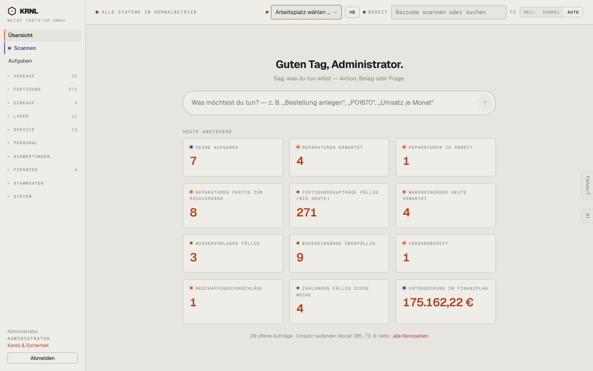

# A00-rahmen — Globaler Rahmen (Seitenleiste, Kopfleiste, Laschen)

- **Bereich:** Querschnitt
- **Route:** `(auf allen Seiten)`
- **Note:** 3 / 5
- **Zweck:** App-Rahmen auf jeder Seite: Seitenleiste mit Gruppen, Kopfleiste (Systemstatus, Arbeitsplatz, Befehlsfeld, Bereit-Anzeige, Scanfeld, Theme), seitliche Laschen „Fehler?“ und „KI“.

## Was gut ist

- Eigenständige, ruhige Werkstatt-Ästhetik (Papier/Aluminium, Orange als Signal, Mono für Technik).
- Gruppen mit Zählern zeigen, wo Arbeit liegt.
- Scanfeld global erreichbar (F2) — passend für Lager/Packtisch.

## Befunde

| Schwere | Kategorie | Befund | Vorschlag |
|---|---|---|---|
| **hoch** | Navigation | „Scannen“ ist dauerhaft violett hinterlegt/markiert und wirkt wie der aktive Menüpunkt — auch auf Sprechen, Konto oder Aufgaben. Der echte aktive Punkt (z. B. Aufgaben, orangefarbene Linie) konkurriert damit. | Kernfunktionen über Icon/Farbe kennzeichnen, aber nur den aktiven Punkt hinterlegen. |
| **hoch** | Navigation | Alle Gruppen sind zugeklappt; die Seitenleiste zeigt nur Versalien-Überschriften (VERKAUF, FERTIGUNG …). Ein neuer Nutzer sieht keinen einzigen Menüpunkt und muss raten, wo „Retouren“ oder „Stücklisten“ liegen. | Aktive Gruppe immer offen, zuletzt genutzte Gruppen offen merken; Gruppen-Icons; Suche im Menü. |
| **mittel** | Daten | Gruppen-Zähler mischen Bedeutungen (Verkauf 32 = offene Aufträge? Fertigung 271 = alle offenen MOs) und sind ohne Erklärung; große Zahlen wie 271 werden ignoriert. | Zähler nur für „braucht mich jetzt“, Tooltip mit Bedeutung, Farbe bei Überfälligkeit. |
| **mittel** | Layout | Kopfleiste ist überladen: Statustext, Arbeitsplatzwahl (in Warnfarbe umrandet, obwohl optional), ⌘K-Taste, „BEREIT“-Leuchte ohne Bedeutung, Scanfeld, „F2“, Theme-Umschalter — sieben Elemente in Mono-Versalien. | Systemstatus als Leuchte mit Tooltip, Arbeitsplatz nur zeigen, wenn Drucker eingerichtet; „BEREIT“ in die Scan-Box integrieren; Theme ins Konto-Menü. |
| **mittel** | Layout | Die Laschen „Fehler?“ und „KI“ am rechten Rand liegen über Inhalt und Tabellen (sichtbar auf vielen Seiten) und sind hochkant schwer lesbar. | In die Kopfleiste (Icon-Knöpfe) oder als schwebender runder Knopf unten rechts mit Abstand zum Inhalt. |
| **mittel** | Typografie | Durchgängig sehr kleine Mono-Versalien mit Sperrung (Gruppen, Labels, Status) in grauer Farbe — Lesbarkeit und Kontrast leiden, besonders auf Monitoren im Lager. | Mindestgröße 12 px für Labels, Versalien nur für Abschnittsköpfe, Kontrast ≥ 4.5:1. |
| **niedrig** | Konsistenz | Benutzerblock unten links: Name, Rolle in Versalien, „Konto & Sicherheit“ in Orange, „Abmelden“ als Knopf — vier Stile auf engem Raum. | Avatar + Name, Menü mit Konto/Theme/Abmelden. |
| **niedrig** | Mobil | Im Seitenleisten-Fuß ist kein Platz für mehr Gruppen; bei aufgeklappten Gruppen scrollt die Leiste, der Benutzerblock verschwindet. | Fuß sticky, Gruppen scrollbar. |

[← zur Übersicht](../README.md)
