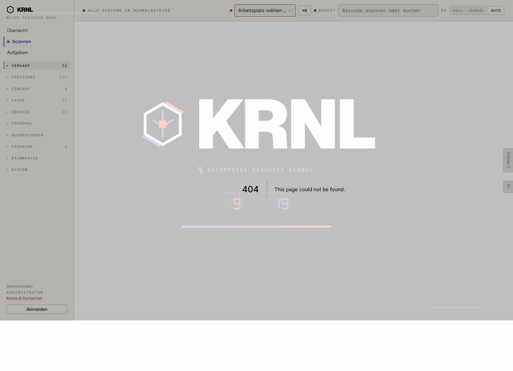

# A01-404-seite — Fehlerseite „nicht gefunden“

- **Bereich:** Querschnitt
- **Route:** `/versand/packzettel (ohne Parameter)`
- **Note:** 1 / 5
- **Zweck:** Fehlerseite (nicht gefunden) – entsteht u. a. bei /versand/packzettel und /fertigung/druck ohne Parameter

## Was gut ist

- Navigation bleibt sichtbar

## Befunde

| Schwere | Kategorie | Befund | Vorschlag |
|---|---|---|---|
| **hoch** | Texte | Standard-Next.js-404 auf Englisch (‚This page could not be found.‘) – die einzige englische Seite im System. | Eigene not-found-Seite auf Deutsch mit Suche und Link zur Übersicht. |
| **hoch** | Layout | Die 404-Meldung liegt über dem halbtransparenten Start-Splash (KRNL-Logo, Zähler ‚Module 9 / Prozesse 19‘, Ladebalken); Text überlagert die Zähler – wirkt kaputt. | Splash nicht auf Fehlerseiten zeigen; Fehlerseite im normalen Seitenrahmen. |

[← zur Übersicht](../README.md)
