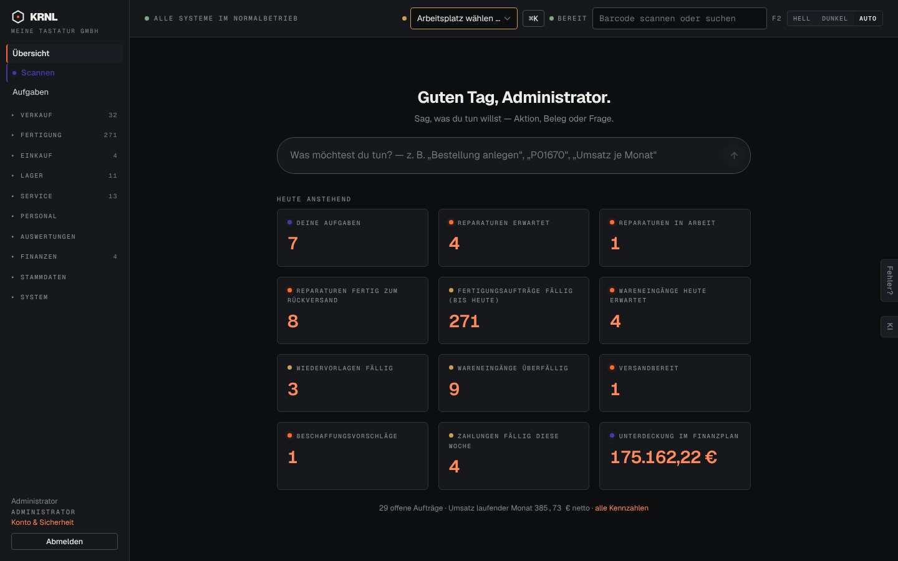

# d01-uebersicht — Übersicht (dunkel)

- **Bereich:** Dunkelmodus
- **Route:** `/`
- **Note:** 4 / 5
- **Zweck:** Übersicht im Dunkelmodus
- **Messwerte:** HTTP 200 · Ladezeit 3609 ms · Seitenhöhe 900 px · horizontaler Überlauf nein · Texte < 11 px: 14

## Was gut ist

- Konsequente dunkle Flächen, Akzentorange gut lesbar
- Kein Bruch in Kacheln

## Befunde

| Schwere | Kategorie | Befund | Vorschlag |
|---|---|---|---|
| **niedrig** | Barrierefreiheit | Kachel-Beschriftungen (Versalien, grau auf fast schwarz) mit geringem Kontrast. | Kontrast ≥ 4,5:1 für Labels. |

[← zur Übersicht](../README.md)
