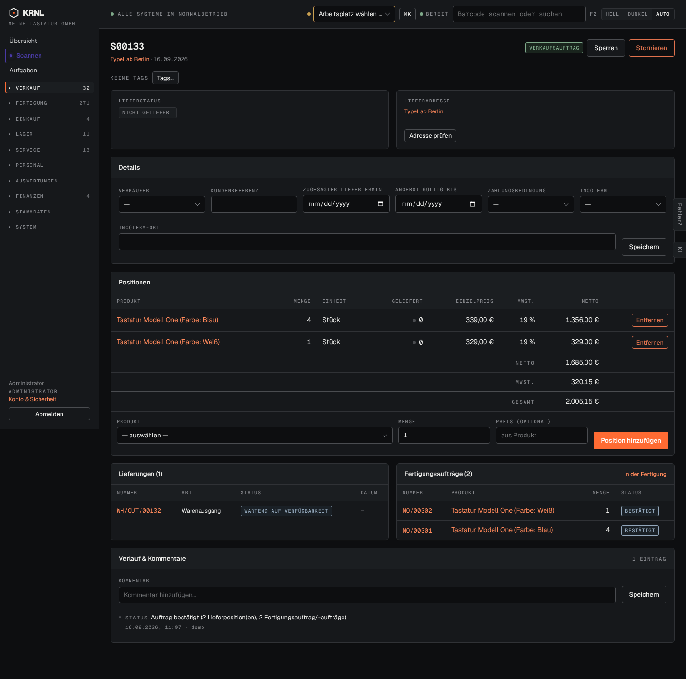

# d02-verkauf — Verkaufsauftrag (dunkel)

- **Bereich:** Dunkelmodus
- **Route:** `/verkauf/406c7929-0feb-43e1-8ac7-236f175341de`
- **Note:** 3 / 5
- **Zweck:** Verkaufsauftrag im Dunkelmodus
- **Messwerte:** HTTP 200 · Ladezeit 790 ms · Seitenhöhe 1425 px · horizontaler Überlauf nein · Texte < 11 px: 54

## Was gut ist

- Tabellen und Formulare korrekt invertiert

## Befunde

| Schwere | Kategorie | Befund | Vorschlag |
|---|---|---|---|
| **mittel** | Barrierefreiheit | Native Datumsfelder (mm/dd/yyyy) und Kalender-Icons bleiben hell/kontrastarm; Statusetiketten in Dunkelblau auf Schwarz kaum lesbar (WARTEND AUF VERFÜGBARKEIT, BESTÄTIGT). | color-scheme: dark für Eingaben; Etikettenfarben für Dunkelmodus anheben. |

[← zur Übersicht](../README.md)
