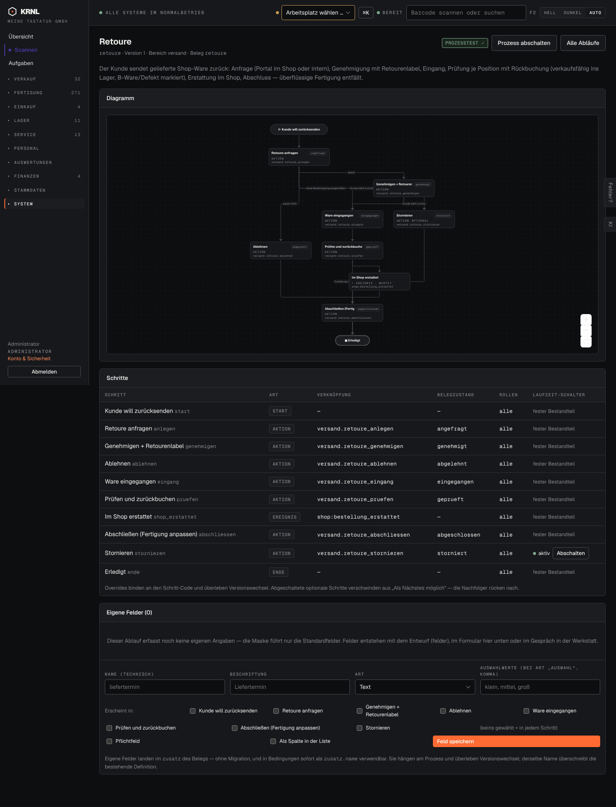

# d03-prozess — Prozessdiagramm (dunkel)

- **Bereich:** Dunkelmodus
- **Route:** `/prozesse/retoure`
- **Note:** 2 / 5
- **Zweck:** Prozessseite im Dunkelmodus
- **Messwerte:** HTTP 200 · Ladezeit 817 ms · Seitenhöhe 1886 px · horizontaler Überlauf nein · Texte < 11 px: 64

## Was gut ist

- Schritttabelle lesbar

## Befunde

| Schwere | Kategorie | Befund | Vorschlag |
|---|---|---|---|
| **hoch** | Barrierefreiheit | Diagramm: Kanten und Knotenrahmen dunkelgrau auf Schwarz praktisch unsichtbar; Zoom-Knöpfe (+/−/Vollbild) als weiße Flächen ohne Symbole. | Diagramm-Tokens für Dunkelmodus (Kanten hell, Knoten mit Rand), Symbole in Zoom-Knöpfen einfärben. |

[← zur Übersicht](../README.md)
