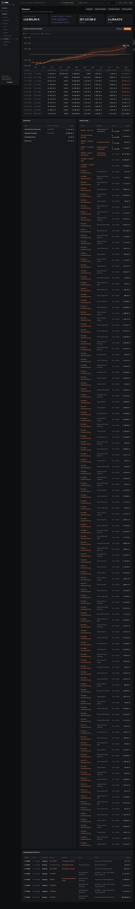

# d04-finanzen — Cashflow (dunkel)

- **Bereich:** Dunkelmodus
- **Route:** `/finanzen`
- **Note:** 3 / 5
- **Zweck:** Finanzen im Dunkelmodus
- **Messwerte:** HTTP 200 · Ladezeit 6655 ms · Seitenhöhe 9612 px · horizontaler Überlauf nein · Texte < 11 px: 59

## Was gut ist

- Diagramm mit Band gut sichtbar
- Negative Salden orange/rot erkennbar

## Befunde

| Schwere | Kategorie | Befund | Vorschlag |
|---|---|---|---|
| **niedrig** | Konsistenz | Fremdkapitalbedarf violett (siehe 850) – im Dunkelmodus zusätzlich kontrastarm. | Gefahrenfarbe aus Tokens. |

[← zur Übersicht](../README.md)
