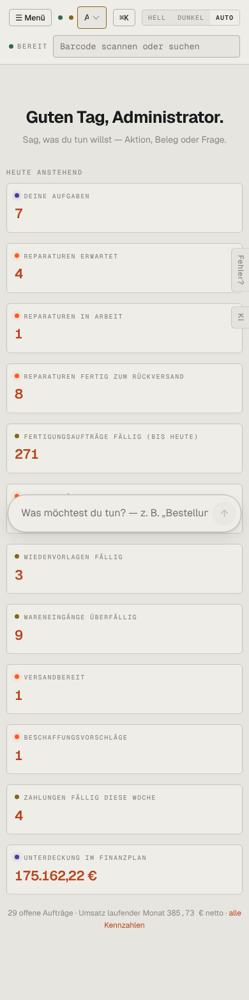

# m01-uebersicht — Übersicht (mobil)

- **Bereich:** Mobil (390 px)
- **Route:** `/`
- **Note:** 3 / 5
- **Zweck:** Übersicht am Handy (390 px)
- **Messwerte:** HTTP 200 · Ladezeit 3726 ms · Seitenhöhe 1563 px · horizontaler Überlauf nein · Texte < 11 px: 14

## Was gut ist

- Kacheln stapeln sauber einspaltig
- Begrüßung und Befehlsfeld erhalten

## Befunde

| Schwere | Kategorie | Befund | Vorschlag |
|---|---|---|---|
| **hoch** | Mobil | Das schwebende Befehlsfeld ‚Was möchtest du tun?‘ liegt mitten über den Kacheln und verdeckt beim Scrollen jeweils eine Kachel vollständig (hier ‚Wareneingänge heute erwartet‘). | Am Handy unten fixiert mit Abstand zum Inhalt (padding-bottom) oder als Knopf, der das Feld öffnet. |
| **mittel** | Mobil | Kopfleiste zweizeilig mit unverständlichen Kürzeln (zwei Punkte, ‚A‘-Auswahl = Arbeitsplatz, ⌘K, HELL/DUNKEL/AUTO) – frisst ~100 px. | Am Handy nur Menü + Scanfeld; Rest ins Menü. |
| **mittel** | Mobil | Seitliche Laschen ‚Fehler?‘ und ‚KI‘ überlappen die Kacheln am rechten Rand. | Am Handy ins Menü verlegen. |

[← zur Übersicht](../README.md)
