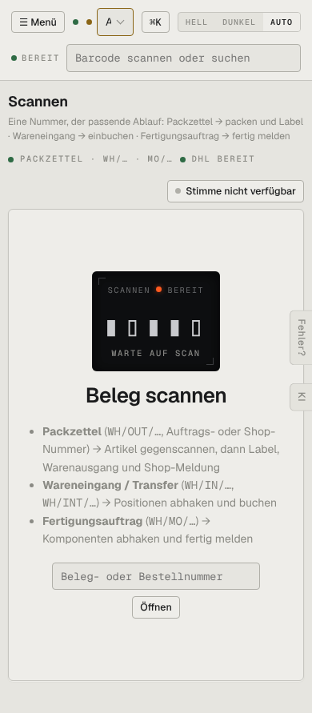

# m02-scanner — Scanner (mobil)

- **Bereich:** Mobil (390 px)
- **Route:** `/scanner`
- **Note:** 3 / 5
- **Zweck:** Scannen am Handy
- **Messwerte:** HTTP 200 · Ladezeit 725 ms · Seitenhöhe 891 px · horizontaler Überlauf nein · Texte < 11 px: 17

## Was gut ist

- Scan-Bereitschaft groß, Erklärliste lesbar

## Befunde

| Schwere | Kategorie | Befund | Vorschlag |
|---|---|---|---|
| **mittel** | Mobil | Keine Kamera-Scan-Funktion sichtbar – am Handy ist das der naheliegende Weg (nur Hardware-Scanner/Eingabe). | Knopf ‚Mit Kamera scannen‘. |
| **niedrig** | Mobil | Statuszeile ‚PACKZETTEL · WH/… · MO/…‘ abgeschnitten. | Umbrechen oder weglassen. |

[← zur Übersicht](../README.md)
