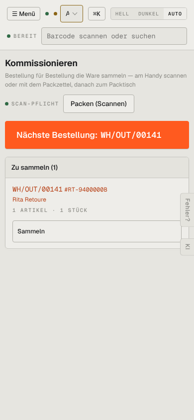

# m04-kommissionieren — Kommissionieren (mobil)

- **Bereich:** Mobil (390 px)
- **Route:** `/kommissionieren`
- **Note:** 4 / 5
- **Zweck:** Kommissionieren am Handy
- **Messwerte:** HTTP 200 · Ladezeit 812 ms · Seitenhöhe 844 px · horizontaler Überlauf nein · Texte < 11 px: 14

## Was gut ist

- Großer Knopf ‚Nächste Bestellung‘ – gut daumenbedienbar
- Liste kompakt

## Befunde

| Schwere | Kategorie | Befund | Vorschlag |
|---|---|---|---|
| **niedrig** | Mobil | Lasche ‚Fehler?‘ überdeckt den Knopf ‚Sammeln‘ teilweise. | Siehe m01. |

[← zur Übersicht](../README.md)
