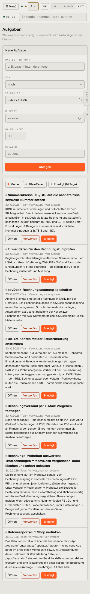

# m05-aufgaben — Aufgaben (mobil)

- **Bereich:** Mobil (390 px)
- **Route:** `/aufgaben`
- **Note:** 3 / 5
- **Zweck:** Aufgaben am Handy
- **Messwerte:** HTTP 200 · Ladezeit 757 ms · Seitenhöhe 2565 px · horizontaler Überlauf nein · Texte < 11 px: 19

## Was gut ist

- Formular einspaltig
- Aufgabenkarten mit vollem Text

## Befunde

| Schwere | Kategorie | Befund | Vorschlag |
|---|---|---|---|
| **mittel** | Mobil | Formular ‚Neue Aufgabe‘ steht vor der Liste – auf dem Handy erst nach ~700 px Scrollen die eigentlichen Aufgaben. | Liste zuerst, ‚+ Aufgabe‘ als schwebender Knopf. |
| **mittel** | Mobil | Je Aufgabe drei Knöpfe (Öffnen, Verwerfen rot, Erledigt orange) in einer Zeile – Fehlklick-Gefahr beim Daumen. | Wischgesten oder ein Primärknopf + Menü. |
| **niedrig** | Eingabe | Datum ‚10/17/2026‘ US-Format. | de-DE. |

[← zur Übersicht](../README.md)
