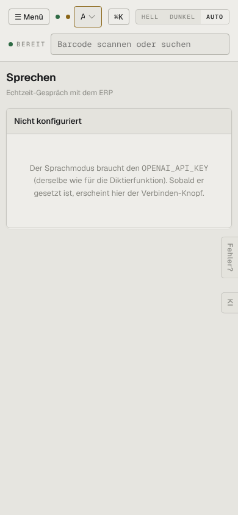

# m06-sprechen — Sprechen (mobil)

- **Bereich:** Mobil (390 px)
- **Route:** `/sprechen`
- **Note:** 3 / 5
- **Zweck:** Sprachmodus am Handy
- **Messwerte:** HTTP 200 · Ladezeit 709 ms · Seitenhöhe 844 px · horizontaler Überlauf nein · Texte < 11 px: 13

## Was gut ist

- Klare Meldung, was fehlt

## Befunde

| Schwere | Kategorie | Befund | Vorschlag |
|---|---|---|---|
| **niedrig** | Texte | Umgebungsvariable OPENAI_API_KEY im Anwendertext. | ‚Sprachmodus ist noch nicht eingerichtet – Administrator: Einstellungen → KI‘. |

[← zur Übersicht](../README.md)
