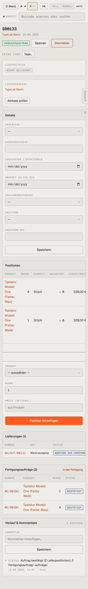

# m07-verkauf-detail — Verkaufsauftrag (mobil)

- **Bereich:** Mobil (390 px)
- **Route:** `/verkauf/406c7929-0feb-43e1-8ac7-236f175341de`
- **Note:** 2 / 5
- **Zweck:** Verkaufsauftrag am Handy
- **Messwerte:** HTTP 200 · Ladezeit 759 ms · Seitenhöhe 2588 px · horizontaler Überlauf nein · Texte < 11 px: 54

## Was gut ist

- Karten stapeln einspaltig

## Befunde

| Schwere | Kategorie | Befund | Vorschlag |
|---|---|---|---|
| **hoch** | Mobil | Positionstabelle nur seitlich scrollbar (Einzelpreis angeschnitten, Netto/Entfernen erst nach Wischen sichtbar, kein Scroll-Hinweis); Produktnamen brechen Wort für Wort um. | Positionen am Handy als Karten (Name, Menge × Preis, Summe). |
| **mittel** | Mobil | Details-Formular (6 leere Felder) vor den Positionen. | Details einklappen. |

[← zur Übersicht](../README.md)
