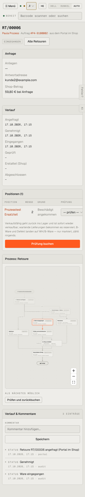

# m08-retoure-pruefen — Retoure prüfen (mobil)

- **Bereich:** Mobil (390 px)
- **Route:** `/versand/retouren/c00cb487-bab9-43eb-a40e-c0b48a5965ce`
- **Note:** 3 / 5
- **Zweck:** Retoure am Handy prüfen
- **Messwerte:** HTTP 200 · Ladezeit 1034 ms · Seitenhöhe 2274 px · horizontaler Überlauf nein · Texte < 11 px: 58

## Was gut ist

- Verlauf als Liste gut lesbar
- ‚Prüfung buchen‘ über volle Breite

## Befunde

| Schwere | Kategorie | Befund | Vorschlag |
|---|---|---|---|
| **mittel** | Mobil | Prüf-Auswahl ‚— prüfen —‘ am rechten Tabellenrand angeschnitten (nur durch seitliches Wischen erreichbar); Notizfeld nicht sichtbar. | Positionen als Karten mit Auswahl darunter. |
| **niedrig** | Mobil | Prozessdiagramm am Handy winzig und nutzlos. | Am Handy nur Stepper. |

[← zur Übersicht](../README.md)
