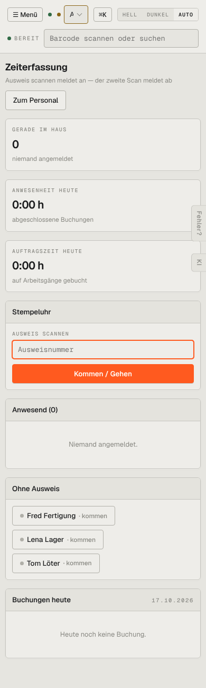

# m09-zeiterfassung — Zeiterfassung (mobil)

- **Bereich:** Mobil (390 px)
- **Route:** `/zeiterfassung`
- **Note:** 4 / 5
- **Zweck:** Stempeluhr am Handy
- **Messwerte:** HTTP 200 · Ladezeit 716 ms · Seitenhöhe 1300 px · horizontaler Überlauf nein · Texte < 11 px: 18

## Was gut ist

- Großes Scanfeld + Knopf über volle Breite
- Schnellknöpfe je Mitarbeiter

## Befunde

| Schwere | Kategorie | Befund | Vorschlag |
|---|---|---|---|
| **niedrig** | Mobil | Kennzahlkacheln vor der Stempeluhr – die Hauptfunktion erst nach Scrollen. | Stempeluhr zuerst. |

[← zur Übersicht](../README.md)
