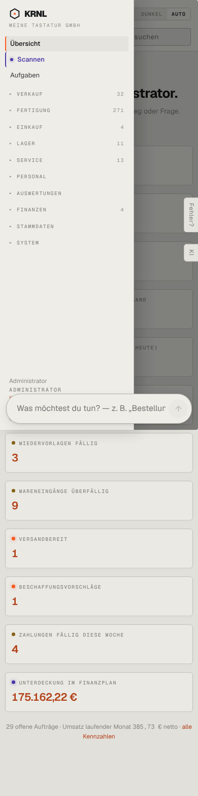

# m10-navigation — Navigation offen (mobil)

- **Bereich:** Mobil (390 px)
- **Route:** `/`
- **Note:** 3 / 5
- **Zweck:** Geöffnetes Menü am Handy
- **Messwerte:** HTTP 200 · Ladezeit 3596 ms · Seitenhöhe 1563 px · horizontaler Überlauf nein · Texte < 11 px: 14

## Was gut ist

- Schublade von links mit abgedunkeltem Hintergrund
- Bereiche mit Zählern

## Befunde

| Schwere | Kategorie | Befund | Vorschlag |
|---|---|---|---|
| **hoch** | Mobil | Das schwebende Befehlsfeld liegt über der geöffneten Navigation und verdeckt Benutzername/‚Abmelden‘. | Befehlsfeld bei offener Navigation ausblenden (z-index). |
| **mittel** | Navigation | ‚Übersicht‘ (aktiv, orange) und ‚Scannen‘ (violetter Punkt) gleichzeitig hervorgehoben (siehe A00); Violett ist laut Designsystem der Entscheidungsakzent und passt nicht zu einem Menüpunkt. | Ein aktiver Zustand. |
| **niedrig** | Mobil | Bereiche nur aufklappbar, kein Direkteinstieg; Versalien-Mono-Schrift 11 px. | Größere Touch-Ziele (≥ 44 px), normale Schrift. |

[← zur Übersicht](../README.md)
