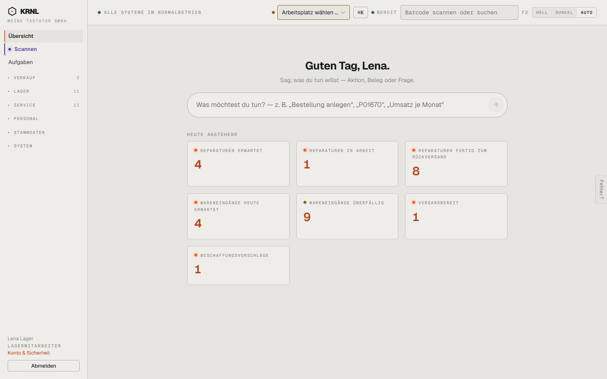

# r01-lager-uebersicht — Übersicht als Lager

- **Bereich:** Rollen
- **Route:** `/`
- **Note:** 3 / 5
- **Zweck:** Übersicht für Rolle Lager (Lena Lager)
- **Messwerte:** HTTP 200 · Ladezeit 3350 ms · Seitenhöhe 900 px · horizontaler Überlauf nein · Texte < 11 px: 13

## Was gut ist

- Navigation auf erlaubte Bereiche reduziert
- Kacheln rollenbezogen

## Befunde

| Schwere | Kategorie | Befund | Vorschlag |
|---|---|---|---|
| **mittel** | Logik | Lagermitarbeiterin sieht Reparatur-Kacheln (erwartet/in Arbeit/fertig zum Rückversand) und den Bereich SYSTEM; ‚Deine Aufgaben‘ fehlt. | Kacheln je Rolle kuratieren (Lager: Versandbereit, Wareneingänge, Kommissionieren, Retouren zu prüfen). |
| **niedrig** | Navigation | Zähler ‚VERKAUF 3‘ in der Navigation, obwohl der Verkaufsbereich selbst gesperrt ist (r02) – Gruppe enthält wohl Versand/Retouren, heißt aber Verkauf. | Gruppenname nach Inhalt (‚Versand‘) bzw. nur erlaubte Einträge zählen. |

[← zur Übersicht](../README.md)
