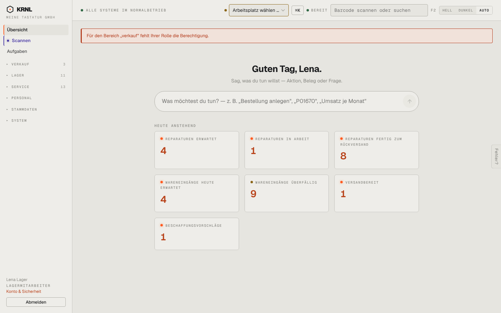

# r02-lager-verkauf-verboten — Lager öffnet /verkauf

- **Bereich:** Rollen
- **Route:** `/verkauf`
- **Note:** 3 / 5
- **Zweck:** Rolle Lager ruft einen gesperrten Bereich auf
- **Messwerte:** HTTP 200 · Ladezeit 3319 ms · Seitenhöhe 900 px · horizontaler Überlauf nein · Texte < 11 px: 13

## Was gut ist

- Umleitung auf Übersicht statt Fehlerseite
- Rote Meldung oben

## Befunde

| Schwere | Kategorie | Befund | Vorschlag |
|---|---|---|---|
| **mittel** | Texte | Meldung ‚Für den Bereich „verkauf“ fehlt Ihrer Rolle die Berechtigung.‘ – technischer Bereichscode kleingeschrieben, Siezen (sonst duzt die Oberfläche: ‚Was möchtest du tun?‘). | ‚Verkauf ist für deine Rolle nicht freigegeben – frag eine Administratorin/einen Administrator.‘ Einheitliche Anrede. |

[← zur Übersicht](../README.md)
