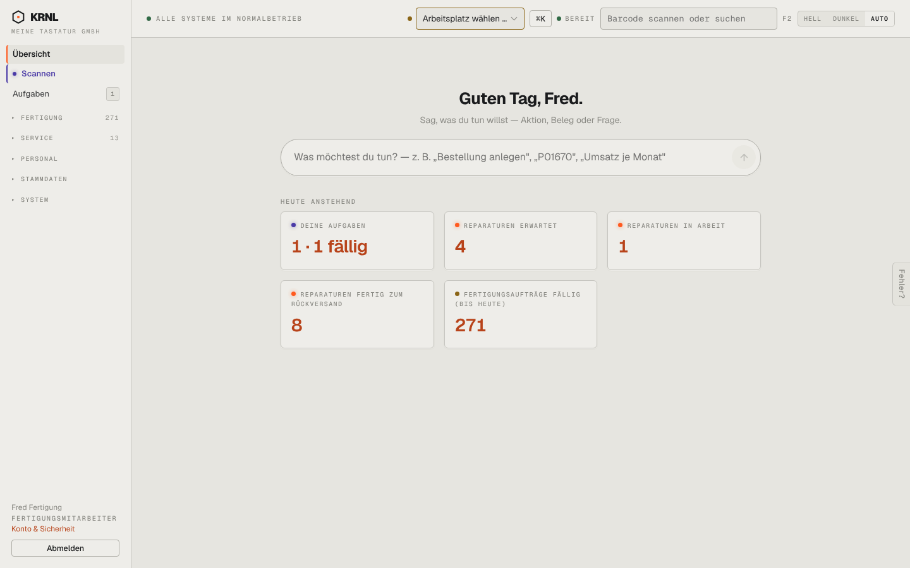

# r03-fertigung-uebersicht — Übersicht als Fertigung

- **Bereich:** Rollen
- **Route:** `/`
- **Note:** 3 / 5
- **Zweck:** Übersicht für Rolle Fertigung (Fred Fertigung)
- **Messwerte:** HTTP 200 · Ladezeit 3201 ms · Seitenhöhe 900 px · horizontaler Überlauf nein · Texte < 11 px: 14

## Was gut ist

- ‚Deine Aufgaben 1 · 1 fällig‘ persönlich
- Navigation reduziert

## Befunde

| Schwere | Kategorie | Befund | Vorschlag |
|---|---|---|---|
| **mittel** | Logik | ‚Fertigungsaufträge fällig (bis heute) 271‘ – die wichtigste Kachel für die Rolle ist durch Altdaten unbrauchbar; keine Kachel ‚startbar (Material vollständig)‘. | Kacheln ‚Heute starten‘, ‚Material fehlt‘, ‚Überfällig‘. |
| **niedrig** | Logik | Fertigung sieht ebenfalls SYSTEM und Reparaturkacheln. | Rollenkuratierung. |

[← zur Übersicht](../README.md)
